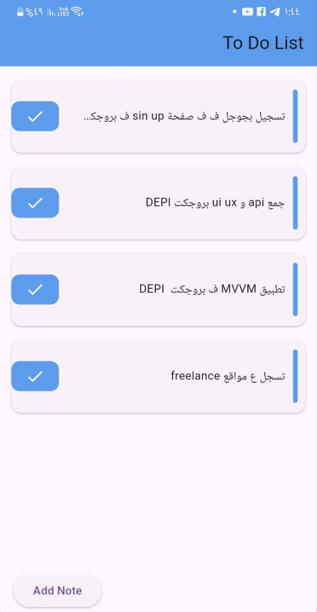
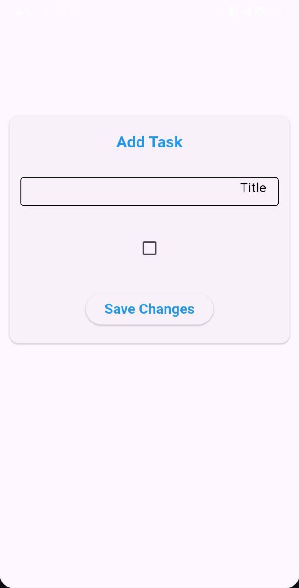
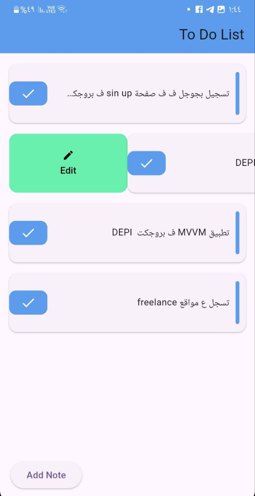
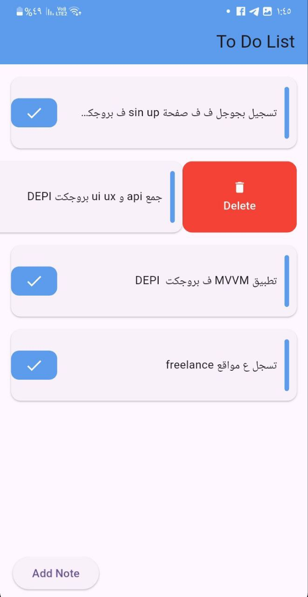
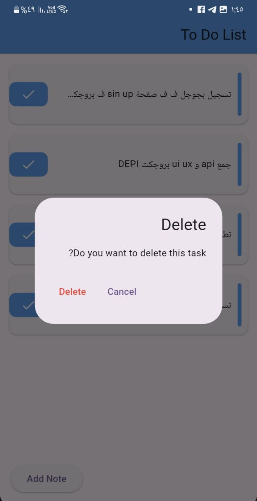

# Task Manager App

A simple Flutter task manager where you can add, edit, delete, and mark tasks as completed. Tasks are saved locally, so they stay after you close the app.

Screenshots
<table> <tr> <td align="center"><b>Task List</b></td> <td align="center"><b>Add Task</b></td> <td align="center"><b>Edit (swipe right)</b></td> </tr> <tr> <td></td> <td></td> <td></td> </tr> <tr> <td align="center"><b>Delete (swipe left)</b></td> <td align="center"><b>Delete confirmation</b></td> <td></td> </tr> <tr> <td></td> <td></td> <td></td> </tr> </table>

## Features

- Add a new task with a title
- Mark tasks as completed
- Edit a task by swiping right
- Delete a task by swiping left, with a confirmation dialog
- Tasks are saved locally and persist across app sessions

## Tech Stack

| Category | Tools |
|----------|-------|
| Framework | Flutter, Dart |
| State Management | setState |
| Local Storage | Floor (SQLite) |
| Version Control | Git, GitHub |

## Getting Started

### Prerequisites

- Flutter SDK installed ([installation guide](https://docs.flutter.dev/get-started/install))

### Setup

1. Clone the repository:
   ```bash
   git clone https://github.com/MeronaRomany/task-manager-flutter.git
   cd task-manager-flutter
   ```
2. Install dependencies:
   ```bash
   flutter pub get
   ```
3. Generate the Floor database code:
   ```bash
   dart run build_runner build --delete-conflicting-outputs
   ```
4. Run the app:
   ```bash
   flutter run
   ```

## Author

**Merona Romany Khalil** | [LinkedIn](https://linkedin.com/in/merona-romany-khalil-62b191362) | [GitHub](https://github.com/MeronaRomany)
